# AxH — Hidan Revamp v5

> **Skin lain di repo ini:** [Shisui x Suyou — Dark Green Revamp](shisui/README.md). Semua efek dominan hijau
> gelap, lebih besar dan brutal, tekstur HD 2×, fade-in/out di semua efek, plus ikon skill baru.
>
> **Map:** [Sanctum Island — HD Remaster v5 (grafik High)](sanctum/README.md). Tekstur AI 2× yang bersih (tidak
> burik) dengan warna alami ala referensi Dota 2 (tidak warna-warni), 7 pohon baru yang menempel di tembok lane
> (tidak menghalangi jalur), daun jatuh dari setiap pohon, sedikit bunga kalem, kerikil, dan daun
> gugur di pinggiran rumput, relief lebih timbul, bayangan bangunan + AO + emboss/PBR (baked), pantulan air lebih
> tajam, dan 32 efek ambient.

**Unduh:** [`release/Hidan.Revamp.v5.zip`](release/Hidan.Revamp.v5.zip)

Isinya 99 file dengan struktur folder (`HIDAN/Art`, `HIDAN/UI`, `HIDAN/Audio`) yang sama persis dengan
`Hidan.Revamp.zip` di rilis [AxH](https://github.com/yuuichi1286-hash/AxH/releases/tag/AxH). Cara pasangnya juga
sama: timpa file lama dengan file di zip ini. v5 sudah mencakup semua perbaikan v4, v3 dan v2 (lihat bagian di bawah).

## Yang baru di v5: grafik Low sampai Ultra tampil Ultra, efek lebih brutal

### Efek sama persis di semua grafik

MLBB memecah efek menjadi efek dasar dan "split node" (`zzp1_*`/`zzp2_*` dan efek tambahan lain di
`FilterInfo.strSpliteNode1/2`). Split node ini hanya dimuat di grafik tinggi, dan di grafik rendah jumlah
partikelnya juga dikurangi (`fGatherNum`). Sekarang:

- **36 lapisan khusus Ultra digabung langsung ke 22 efek dasarnya** (853 objek: partikel, renderer, mesh, material,
  tekstur). Lapisan dipasang di bawah root efek, persis seperti yang dilakukan game saat memuatnya, jadi lapisan ini
  muncul juga di Low. Bundle Unity 2017 dan 2019 dicampur tanpa konversi: setiap objek memakai type tree aslinya.
- **37 referensi ke lapisan dari file game skin lain dihapus** (file itu tidak ada di mod). Tanpa ini, grafik tinggi
  akan menampilkan lapisan yang tidak ada di grafik rendah.
- **337 jumlah partikel yang dikurangi di grafik rendah dikembalikan penuh** (`fGatherNum = fDefaultNum`).

### Skin Ultra di semua grafik

Model dasar `hero_argus_skin` dipakai di bawah High. Sekarang model ini memakai tekstur 2048, shader
`Custom/MLBB_Final_Fixed`, dan material dari `hero_argus_skin_high_add` (High/Ultra), disalin byte demi byte. Mesh,
tulang, dan animasi memang sudah sama.

### Efek lebih keren (tema ritual darah Hidan)

Ada 524 sistem partikel di 77 efek tempur yang diubah. Profilnya sama dengan Shisui, tetapi dengan palet crimson:

- Efek lebih besar dan pukulan terasa lebih berat. Percikan dan puing terbang lebih jauh dan lebih cepat.
- Percikan, darah, dan api lebih banyak, tetapi maksimal 60 partikel hidup per sistem.
- Partikel lahir putih-panas, lalu menjadi merah crimson. Saat memudar, warnanya mendingin jadi merah darah gelap
  dengan kurva S yang panjang dan sinematik.
- Cincin kejut dan bloom mengembang sambil memudar. Cipratan, tetesan, dan serpihan darah jatuh dengan gravitasi.
- Bentuk sigil dan glyph ritual Jashin, tanda di tanah, serta hitungan mundur tidak diubah.
- Showcase lobby dan cut-in ult tidak diubah.
- `DelayTime` diperpanjang seperlunya di 28 efek, jadi tidak ada partikel yang terpotong sebelum selesai memudar.

### Optimasi dan catatan

- 13 tekstur duplikat dipakai bersama, tidak disimpan dua kali. Kapasitas partikel (`maxNumParticles`) dihitung
  sesuai kebutuhan.
- Grafik Low sekarang merender sebanyak Ultra, jadi di HP kelas bawah bisa sedikit lebih berat. Ini konsekuensi
  dari "Low = Ultra".
- Shader Ultra tidak punya varian OpenGL ES 2.0, jadi model Ultra butuh OpenGL ES 3 atau Vulkan. HP yang hanya
  mendukung ES 2.0 sudah sangat lama.
- `hero_argus_skin_extlow_add` tetap tidak diubah (lihat daftar di bawah).

## Yang baru di v4: fade-in & fade-out di semua efek, versi sinematik untuk basic attack & pasif

### Semua efek punya fade-in dan fade-out

- **463 dari 463 sistem partikel** mulai dan berakhir di alpha 0. Validator memeriksa ini otomatis, jadi tidak ada
  partikel yang muncul atau hilang mendadak.
- **Tidak ada efek yang terpotong sebelum fade-out selesai.** Setiap efek punya umur (`DelayTime` di
  `ParticleSysMgr`), dan efek dihapus begitu umurnya habis. Di file asli umurnya dipasang mepet, ±0,03 dtk setelah
  partikel terakhir. Sekarang ke-44 efek dicek bersama overlay `zzp1`/`zzp2`-nya dan diperpanjang bila perlu.
- **11 efek mesh yang tadinya "pop".** Mesh ini dimatikan saat masih terlihat. Sekarang semuanya memudar atau
  dissolve sampai selesai sebelum dimatikan. Contohnya puing batu ult yang tenggelam sambil larut, pita dan tanduk
  di `skill4_2`, dan dissolve di `skill01_Hit_03`.

### Basic attack & pasif: fade-in dan fade-out sinematik

Basic attack mencakup `Attack_01–03` dan hit-nya. Pasif mencakup glow pedang `Keep_daoguang`, efek saat pasif
selesai (`xiaosan`), seret pedang `tuodi`, serangan diperkuat `Attack_04_x`, dan `Hit_05`. Setiap partikel diberi
perilaku sesuai perannya:

| Peran | Fade-in | Fade-out |
|---|---|---|
| Tebasan (mesh) | *whip*: membesar 86→100% + kilatan panas | mengembang 12% sambil mendingin ke merah tua (kurva S) |
| Afterimage (echo/ghost) | lebih redup | ekor panjang mulai 1/3 umur, mengembang 18%, hampir hitam-merah |
| Bara / wisp | kepala panas | hidup 1,45× lebih lama dan **melayang naik** |
| Asap / kabut darah | lembut | mengembang 25% dan menggelap jadi hitam-merah |
| Serpihan / tetesan darah | — | **jatuh** oleh gravitasi |
| Bloom / glow | — | mekar 12% saat memudar |
| Tanda di tanah | — | bertahan 1,5× lebih lama, padam perlahan |
| **Pasif selesai** | glow pedang menyala merah-putih | bloom mekar 35% lalu larut jadi merah darah; percikan jadi bara yang naik; inti gelap pedang larut perlahan, tidak lagi putus mendadak |

Umur efek ikut disesuaikan supaya fade-out tampil utuh:

- Basic attack: 0,80 → 1,13 dtk.
- Hit: 0,40 → 0,59 dtk.
- Serangan diperkuat: 1,5 → 2,0 dtk.
- Hit pasif: 1,2 → 1,8 dtk.

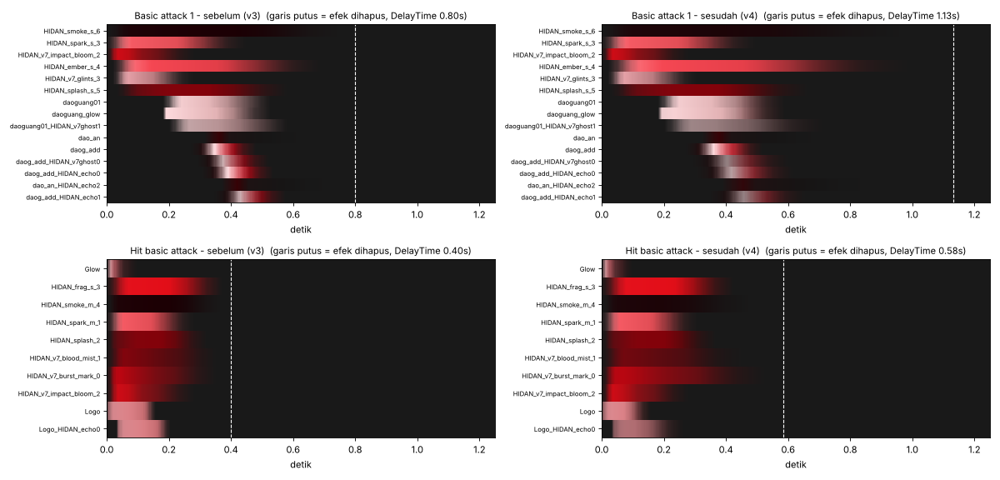
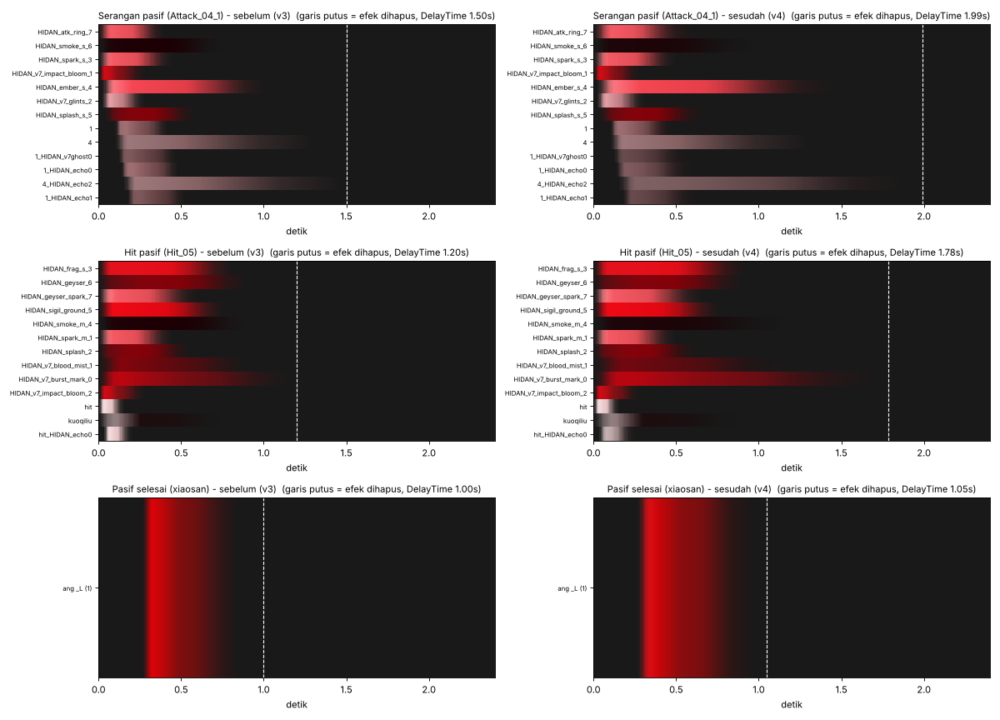
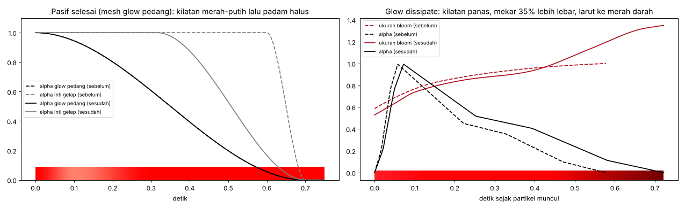

Ada satu keterbatasan. Beberapa mesh statis tidak punya animasi sama sekali: rantai skill 1 selama skill aktif, dan
mesh glow pedang selama pasif aktif. Mesh ini muncul dan hilang bersama objek efeknya, dan menambahkan fade ke
situ butuh komponen animasi baru. Untuk glow pedang, akhirnya sudah tertutup oleh efek "pasif selesai" di atas.

---

## Yang baru di v3

### Model lebih detail

- **Geometri 4× lebih rapat (Phong tessellation).** Setiap segitiga dibagi empat, dan titik barunya dibulatkan
  mengikuti normal permukaan, jadi siluet kepala, bahu, lengan, dan jubah lebih bulat.
  - Mesh normal: 1.566 → 4.365 vertex (1.407 → 5.628 segitiga).
  - Mesh ritual: 1.632 → 4.488 vertex (1.418 → 5.672 segitiga).
  - Sabit dan tombak sengaja dikunci supaya bentuknya tidak menggembung. Seam UV dan tepi tajam tetap rapat
    (tidak ada retakan).
- **Tekstur High jadi 2048²** (sebelumnya 1024²). Tekstur Normal tetap 1024².
- **Line art lebih bersih dan tajam.** Noise sisa upscale "cat AI" di area datar dibersihkan dengan filter
  bilateral. Penajaman hanya dipakai di tepi, jadi noise dan blok kompresi tidak ikut menguat.
- **Padding pulau UV.** Warna pulau didorong ke area kosong di sekitarnya, jadi mipmap tidak lagi memunculkan garis
  gelap di tepi bagian model saat dilihat dari jauh.
- **Pewarnaan.** Awan Akatsuki dan bilah sabit jadi crimson yang lebih kaya. Jubah hitam kebiruan ala anime. Rambut
  dan logam perak dingin. Kontras diberi kurva S yang lembut.

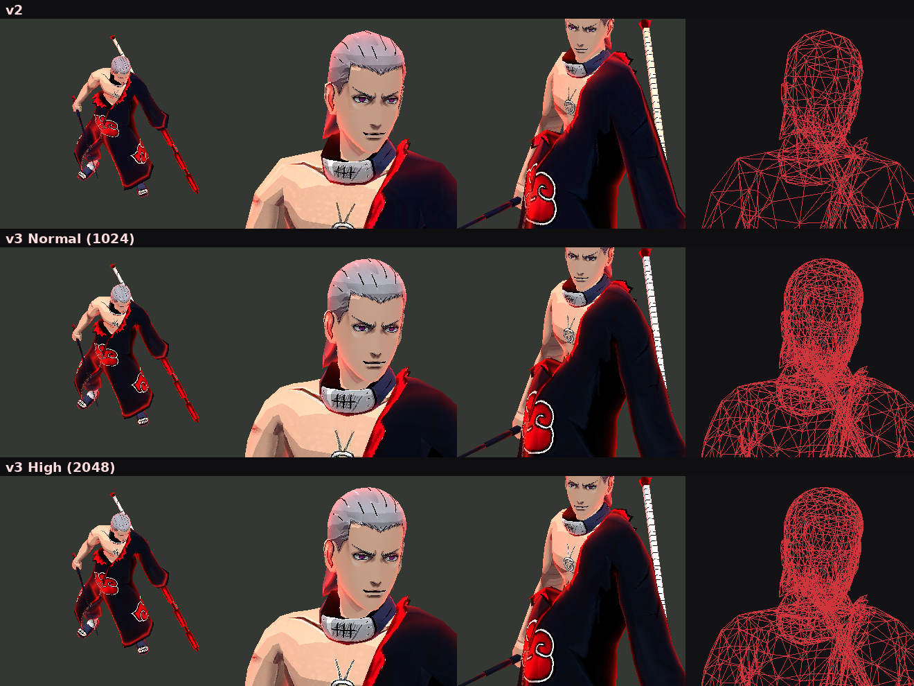

### Efek lebih tajam, warna lebih keren, gerak lebih halus

- **456 tekstur efek ditajamkan.** Penajaman hanya di tepi, jadi tebasan, percikan, simbol Jashin, dan flipbook
  darah lebih tegas. Ada 79 peta noise/dissolve/flow yang sengaja tidak disentuh karena peta itu menggerakkan
  efek, bukan warna.
- **Tekstur darah berwarna di-grade jadi crimson.** Sebelumnya warnanya pink.
- **Fade partikel berbentuk kurva S** (ease-in/ease-out, 466 gradien), bukan ramp linear lagi. Partikel muncul dan
  hilang lebih lembut.
- **39 kurva warna/alpha efek mesh** diberi tangen otomatis, jadi tidak ada sudut patah di tengah fade.
- **Percikan yang belum punya Limit Velocity** diberi drag (melambat halus) dan ukurannya mengecil di akhir umur.
  Percikan "HIDAN_" yang sudah punya keduanya tidak diubah.
- Encoder ASTC memakai preset THOROUGH. Format, ukuran, dan jumlah mip tetap sama dengan aslinya.

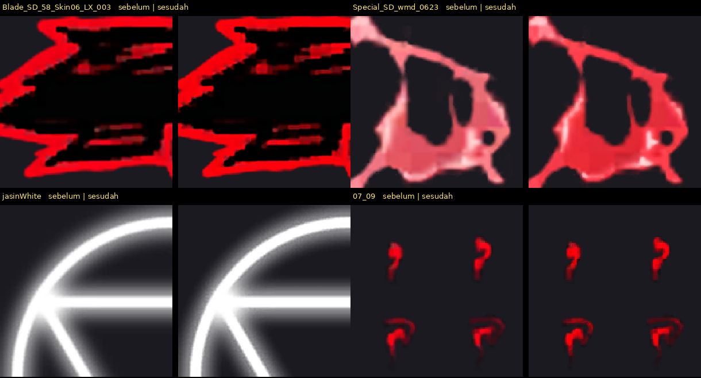
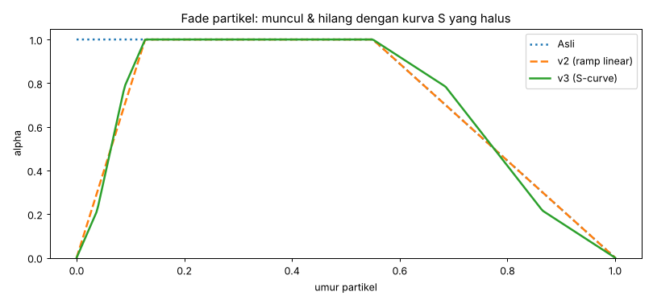

### Animasi lebih halus lagi

Ada penghalusan tambahan di titik-titik yang kecepatan sudutnya berubah mendadak. Lebar penghalusannya berubah
bertahap dan tetap dibatasi kecepatan, jadi ayunan dan putaran cepat tidak hilang.

- Sentakan (persentil-99) turun **20% lagi** dibanding v2, atau **62% lebih rendah** dari animasi asli.
- Contoh, asli → v2 → v3:

| Klip | Asli | v2 | v3 |
|---|---|---|---|
| attack1 | 25,8 | 11,8 | 9,3 |
| attack4 | 32,2 | 13,1 | 10,9 |
| skill3 (ult) | 35,0 | 11,6 | 8,1 |
| skill4_2 | 41,7 | 14,2 | 12,2 |

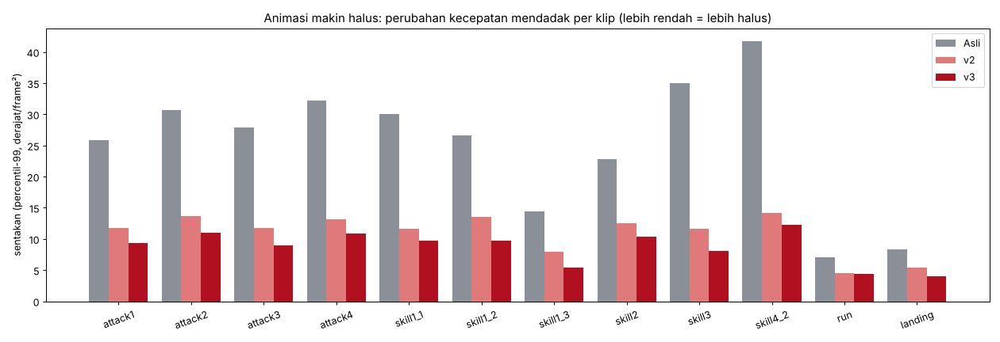

**Konsekuensi:**

- Bundle High bertambah sekitar 2 MB karena tekstur 2048².
- Tiap mesh sekarang sekitar 4,4 ribu vertex. Angka ini masih wajar untuk hero MOBA.

---

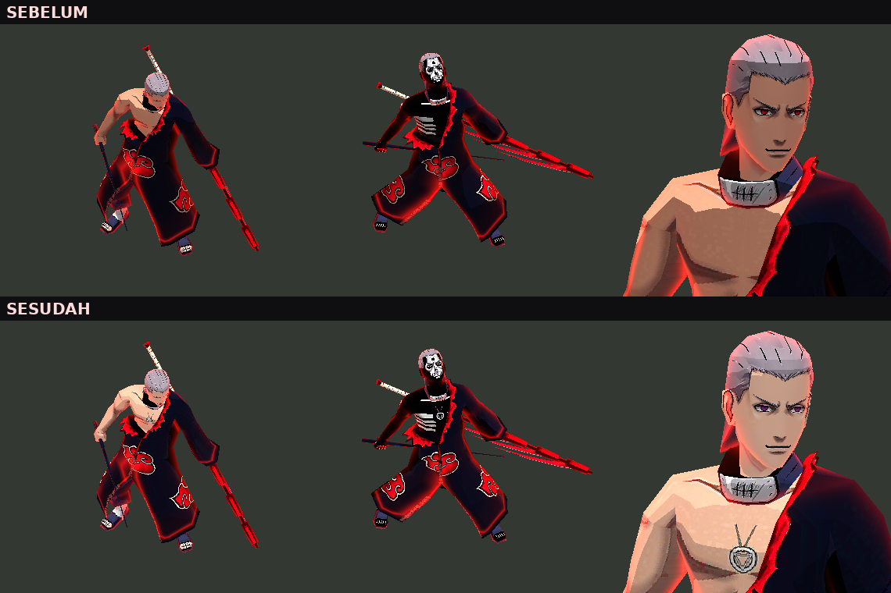

## 1. Model lebih mirip Hidan (kualitas Normal & High)

- **Mata**: iris merah ala Sharingan diganti ungu-violet, warna mata kanon Hidan. Berlaku untuk wajah normal dan
  wajah ritual (tengkorak).
- **Kulit** lebih pucat dan tidak oranye lagi, sesuai kulit Hidan yang terang.
- **Liontin Jashin** (lingkaran + segitiga terbalik) dengan tali di dada. Liontin ini juga terlihat di mode ritual
  (skill 3).
- **Shading toon 3 tingkat.** Sebelumnya, karena arah cahaya toon lurus dari atas, wajah dan badan depan tampil
  ~50% gelap. Sekarang wajah dan badan lebih terang dan lebih jelas dari kamera MLBB.
- **Tekstur** diubah jadi ETC2 RGB dengan mipmap penuh. Ukurannya turun dari 1 MB ke 0,68 MB (kanal alpha memang
  tidak dipakai), dan tekstur tidak lagi "berkilau"/bergerigi saat dilihat dari jauh.
- Model *extra low* (`hero_argus_skin_extlow_add`) tidak diubah. Model itu sudah Hidan versi detail dengan mata
  ungu.

## 2. Animasi tidak patah-patah lagi

Penyebab yang ditemukan di data animasi:

| Masalah | Contoh |
|---|---|
| **Snap**: tulang berputar 100–190° dalam 1–2 frame sehingga terlihat seperti teleport | attack4/5, skill2, skill3, skill4_2 |
| **Kink**: kecepatan gerak berubah mendadak antar keyframe, terasa robotik | hampir semua serangan |
| **Sambungan loop lari**: lutut di akhir siklus beda 6,5° dari awal siklus, jadi tersendat tiap 0,88 dtk | run, run2 |
| **Putaran sabit ekstrem**: ~9 putaran dalam 0,58 dtk, tampak "strobo" di 30 fps | skill1_1 |

Perbaikan:

- Setiap snap diganti tween *ease-in/out* (slerp), jadi tampil sebagai ayunan cepat yang tetap terlihat.
- Putaran ekstrem dikurangi jumlah putarannya. Pose awal dan akhir tidak berubah.
- Smoothing ringan dipakai di semua tulang, dengan batas kecepatan supaya putaran cepat yang memang disengaja tidak
  hilang.
- Sambungan loop run, run2, dan fight_idle sekarang 0°.
- Pergantian mesh normal ↔ ritual di skill3 tetap tepat waktu. Pergantian disimpan sebagai *step* presisi, jadi
  tidak ada frame dengan dua mesh tampil bersamaan.
- Transisi Animator: crossfade 0,10 → 0,15 dtk. Masuk ultimate sebelumnya potong keras (0 dtk), sekarang 0,08 dtk.
  Masuk recall 0,25 dtk, keluar recall 0,2 dtk.

| Klip | Durasi | Putaran terbesar per frame (60 fps), sebelum → sesudah |
|---|---|---|
| attack1 | 0.65 dtk | 59° → 30° |
| attack2 | 0.65 dtk | 77° → 34° |
| attack3 | 0.65 dtk | 63° → 30° |
| attack4 | 1.25 dtk | 118° → 38° |
| attack5 | 1.25 dtk | 119° → 38° |
| skill1_1 | 1.75 dtk | 104° → 56° |
| skill1_2 | 0.75 dtk | 38° → 36° |
| skill1_3 | 1.13 dtk | 30° → 30° |
| skill1_4 | 0.45 dtk | 23° → 15° |
| skill2 | 1.25 dtk | 98° → 40° |
| skill3 (ult) | 1.32 dtk | 144° → 38° |
| skill4_2 | 1.10 dtk | 90° → 64° |
| run / run2 | 0.88 dtk (loop) | 20° → 18°, sambungan loop 6,5° → 0° |
| fight_idle | 15.12 dtk (loop) | 4° → 4° |
| recall | 3.05 → 6.50 dtk | lihat bagian 3 |

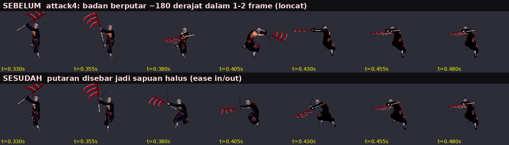

## 3. Recall

- **Sebelumnya**: klip 3,05 dtk yang looping. Pose akhirnya (kuda-kuda) berbeda ~155° dari pose awal (berdiri),
  jadi badan **meloncat** kembali ke pose awal setiap 3 detik.
- **Sekarang**: klip 6,5 dtk tanpa loop. Gerakan aslinya dihaluskan, lalu masuk ke kuda-kuda dengan napas halus
  (dada, kepala, bahu, dan pinggul bergerak sedikit), lalu menetap tenang. Crossfade masuk ke recall juga dibuat
  lebih lembut (0,25 dtk).

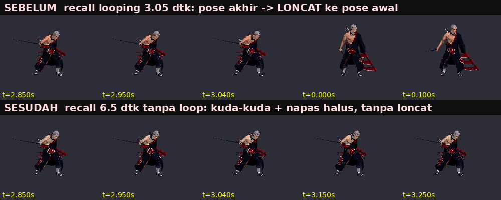

## 4. Efek (VFX): fade, lebih tegas, lebih ringan

- **Fade-in & fade-out di semua efek.** Ke-463 ParticleSystem sekarang mulai dan berakhir di alpha 0: 172 diberi
  fade-in baru, 16 diberi fade-out baru, dan yang sudah punya fade dipertahankan. Ada 8 efek mesh (puing ult,
  sayap ult, plane skill) yang tadinya langsung muncul penuh; sekarang semuanya diberi fade-in.
- **Lebih keren & terdefinisi.** Percikan dan bara lahir "panas" (merah keputihan) lalu turun ke merah darah.
  Semua partikel menggelap ke merah tua sebelum hilang, jadi setiap ledakan terbaca jelas dan tidak lagi berupa
  noda merah yang datar.
- **Optimasi:**
  - NoiseModule pada 104 sistem diturunkan dari Medium/High ke Low.
  - 83 emitter yang terlalu padat dikompres, dengan ukuran partikel sedikit dibesarkan supaya efek tetap terasa
    penuh. Batas maxParticles dipasang pada 89 sistem.
  - 2 tekstur 1254² ETC2 RGBA8 (masing-masing 1,5 MB) diubah jadi 1024² ASTC 5x5.
  - Perkiraan jumlah partikel turun ~29% secara total, dan −55% untuk cast ultimate.

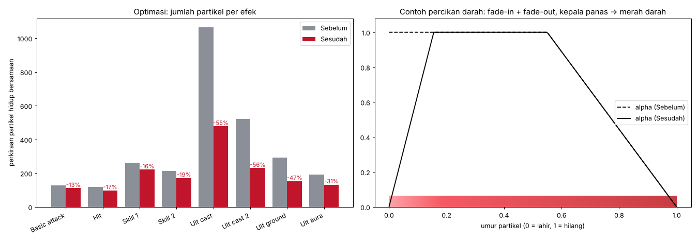

## Validasi

- Setiap bundle dimuat ulang dan setiap objek dibaca ulang. Hasilnya dibandingkan dengan aslinya: flag kompresi dan
  header, nama file internal (CAB), serta set objek semuanya identik. Pengecekan dijalankan dengan
  `tools/validate_all.py`.
- Klip animasi divalidasi: ukuran muscle clip (rumus dikalibrasi dari semua 90+ klip di mod ini), jumlah kurva,
  norma quaternion, dan tidak ada flip hemisphere. Orientasi tekstur model juga dicek.
- Mesh hasil tessellasi juga dicek: indeks valid, jumlah vertex/indeks submesh, bobot tulang = 1, normal satuan, dan
  bounding box per tulang. Rumus bounding box-nya dicocokkan dulu dengan data asli, dengan selisih ~1e-7.
- Build-nya deterministik: menjalankan `tools/build.py` ulang menghasilkan 99 file yang identik byte demi byte.
- Mulai v4 validator juga memeriksa dua hal. Pertama, setiap sistem partikel mulai dan berakhir di alpha 0 (463/463).
  Kedua, tidak ada efek yang dihapus sebelum partikel terakhirnya, termasuk overlay, selesai memudar (44/44).
- Mulai v5 validator memeriksa paritas: tidak ada efek yang masih punya split node atau jumlah partikel yang
  dikurangi (0 dari 48). Setiap objek tambahan juga dicek: bisa dibaca dan semua referensinya valid (853 objek).
  Hasil v5: 0 masalah, fade 572/572, timing 44/44.
- **Belum dites langsung di dalam game.** Di lingkungan build tidak ada perangkat Android maupun MLBB. Kalau ada
  skill yang terlihat aneh, sebutkan nama skill-nya.

File yang sengaja **tidak diubah**: audio, UI, `hero_argus.unity3d` (animasi Argus asli), model extra low, dan
`heroshow_ip03_add` (latar lobby).

> Catatan: memodifikasi file game melanggar ketentuan layanan Moonton dan bisa berisiko untuk akun. Gunakan dengan
> risiko sendiri.

## Build ulang dari Hidan.Revamp.zip asli

```bash
pip install -r tools/requirements.txt
unzip Hidan.Revamp.zip -d orig
python tools/build.py orig/HIDAN out/HIDAN out/report.json        # semua pass (v4)
python tools/merge_overlays.py out/HIDAN out/merge_report.json     # v5: efek Low = Ultra
python tools/skin_ultra.py out/HIDAN                               # v5: skin Ultra di semua grafik
python tools/boost_hidan.py out/HIDAN out/boost_report.json        # v5: efek crimson brutal + DelayTime
python tools/validate_all.py orig/HIDAN out/HIDAN                  # validasi
python tools/make_previews.py orig/HIDAN out/HIDAN docs/previews   # gambar sebelum/sesudah
```

| File | Isi |
|---|---|
| `tools/anim_fix.py` | decode/encode klip Mecanim, despin, despike, smoothing adaptif, loop seam, recall baru, transisi Animator |
| `tools/mesh_tess.py` | Phong tessellation mesh skinned (UV/normal/bobot tulang, bounding box per tulang) |
| `tools/model_tex.py` | mata, kulit, liontin Jashin, grading, line art, padding UV, versi 1024/2048, encoder ETC2 + mipmap |
| `tools/vfx_fix.py` | fade alpha (kurva S), warna, noise, budget partikel, drag/taper percikan, fade & tangen efek mesh |
| `tools/fx_tex.py` | penajaman tepi + grading tekstur efek, encoder ASTC/ETC2 (format & mip sama dengan aslinya) |
| `tools/jerk_metrics.py`, `make_previews_v3.py` | metrik kehalusan animasi dan gambar pratinjau v3 |
| `tools/cinematic.py` | v4: fade sinematik per peran partikel (basic attack & pasif), flare pasif selesai, perbaikan mesh "pop" |
| `tools/merge_overlays.py` | v5: gabung split node ke efek dasar (type tree 2017/2019 dipertahankan), hapus referensi, `fGatherNum`, tekstur duplikat dibagi |
| `tools/skin_ultra.py` | v5: tekstur 2048, shader, dan material High/Ultra untuk model dasar |
| `tools/boost_hidan.py`, `tools/brutal.py` | v5: profil brutal crimson per peran partikel (nama pinyin + nama layer HIDAN) |
| `tools/effect_timing.py` | kapan partikel terakhir benar-benar hilang vs `DelayTime` efek (dipakai build & validator) |
| `tools/make_previews_v4.py`, `make_passive_end_chart.py`, `dump_effect.py` | timeline fade dan inspeksi efek |
| `tools/clipio.py`, `meshio.py`, `fk.py` | parser kurva streamed/dense, vertex buffer, forward kinematics + skinning |
| `tools/toon_preview.py`, `filmstrip.py`, `render_obj.py` | renderer software untuk pratinjau |
| `docs/build_report.json` | rincian perubahan per bundle |
