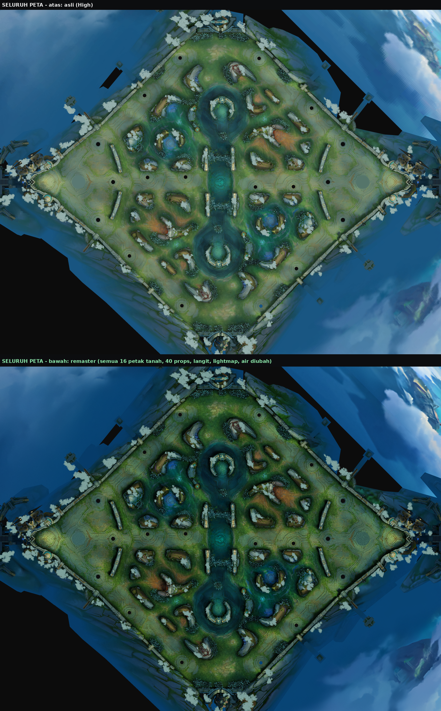
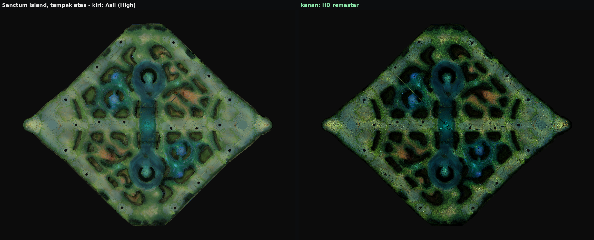
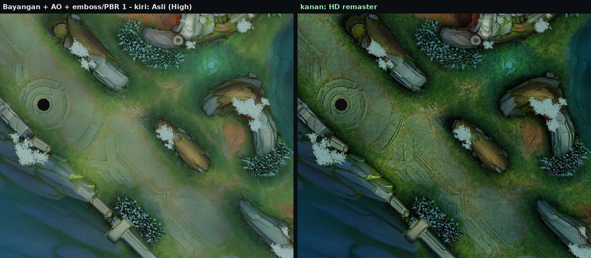
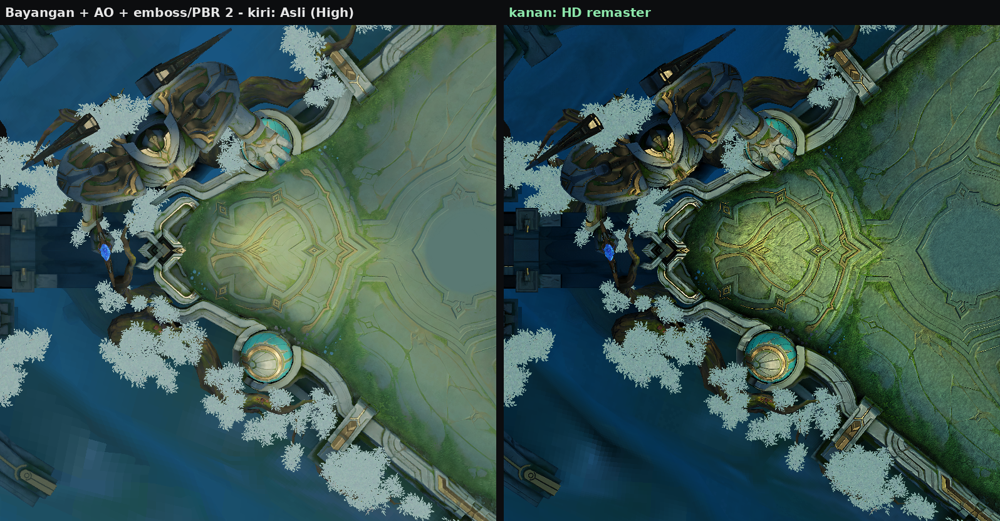
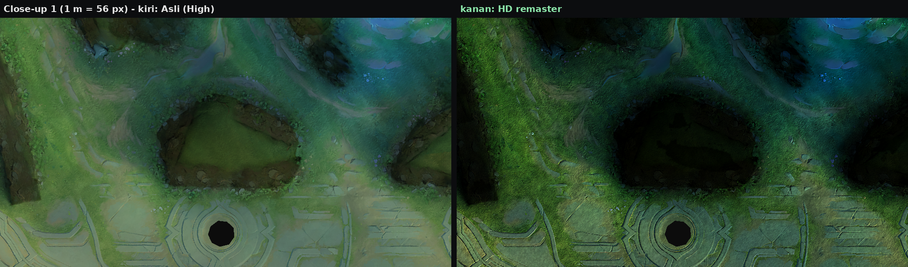
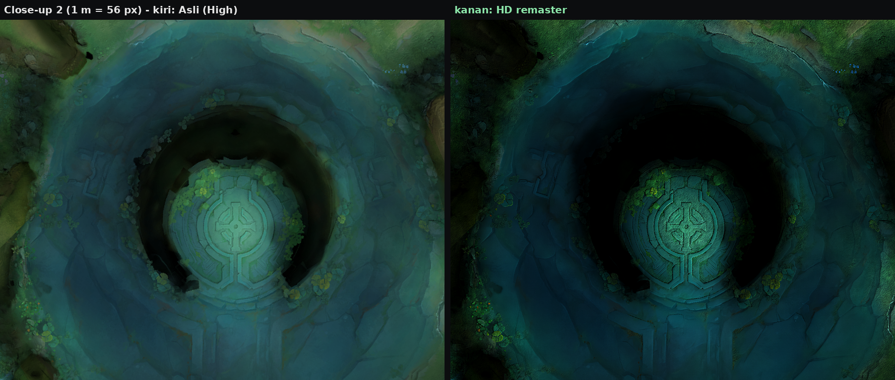
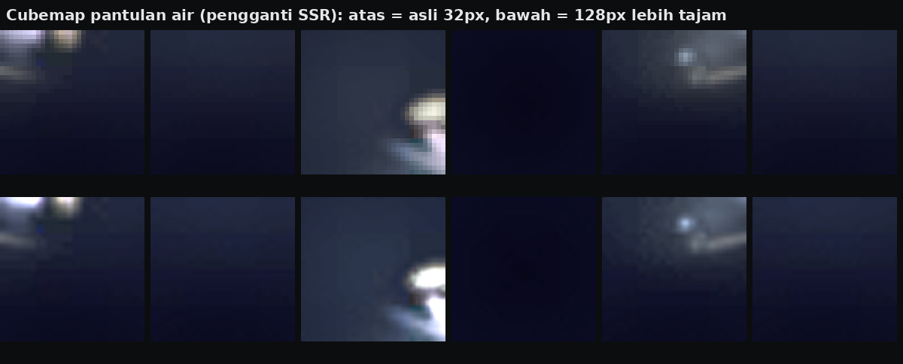
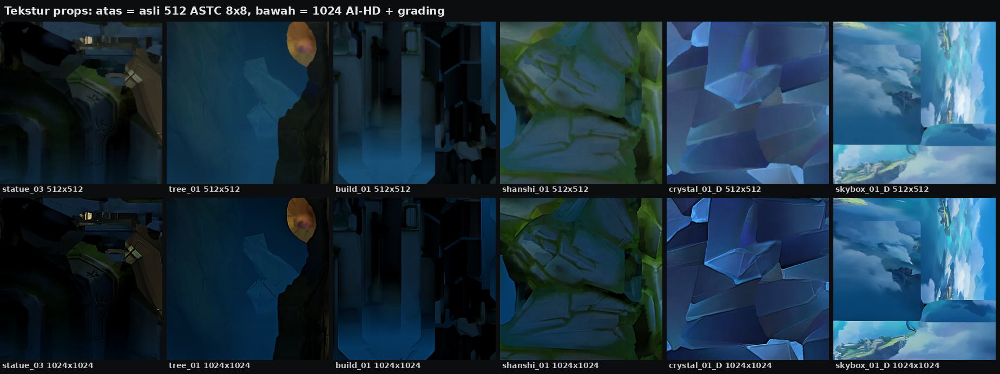
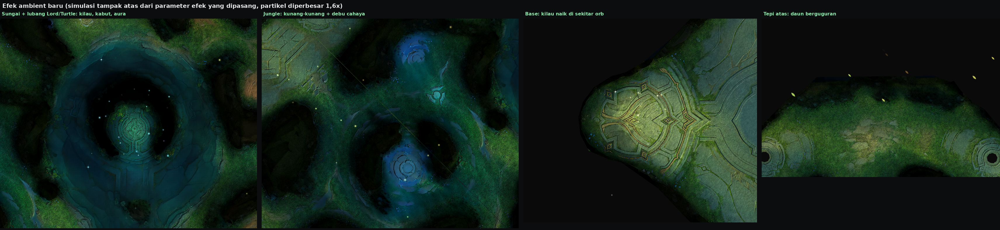

# Sanctum Island — HD Remaster (grafik High)

**Unduh:** [`release/Sanctum_Island_Map_HD.zip`](release/Sanctum_Island_Map_HD.zip) (59 MB) — menggantikan
`Sanctum_Island_Map.zip`.

Struktur zip, nama file, urutan entri, dan kompresinya sama persis dengan file asli (`Scenes/android/...`). Cara
pasangnya juga sama: timpa file lama.

Sesuai permintaan, yang diubah **hanya scene grafik High** (`PVP_049_add.unity3d`). Tujuh file lain disalin
identik byte-per-byte: versi Low `PVP_049_low`, data jalur/tembok A* (`*wall_add`), `PVP_003_add`, `PVP_009`, dan
`GalleryCenter`.

**Seluruh peta High ikut berubah**, bukan hanya beberapa bagian:

- 16 dari 16 petak tanah, termasuk sungai.
- 40 dari 40 tekstur props: bangunan base, patung, tembok, batu jungle, pohon, tebing luar, pilar, kristal.
- Langit dan pulau melayang, 7 lightmap, rumput dan daun 3D, serta pantulan air.

Gambar di bawah adalah seluruh peta beserta bangunannya: atas asli, bawah remaster.



Ada beberapa hal yang memang **bukan bagian dari file map**, sehingga tetap seperti biasa: turret/tower, inti base,
monster jungle, Lord/Turtle, minion, hero, dan efek skill. Semuanya dimuat dari file game lain. Lubang hitam di
gambar tampak atas adalah posisi tower.



## Yang baru di versi ini

- **Pewarnaan lebih gelap di seluruh peta:** tanah, props/bangunan, tebing, dan langit, rata-rata ±25–30% lebih gelap
  dari aslinya, dengan bayangan lebih dalam. Warna tetap kaya, jadi tidak kusam. Props dan bangunan juga mendapat
  kontras lokal dan relief, jadi lebih detail.
- **Rumput dan tanah lebih detail:** serat helai rumput, butiran tanah dan kerikil, plus kontras lokal dua skala.
- **Bayangan setiap bangunan:** 181 bangunan dan props memberi bayangan nyata ke tanah, mengikuti arah cahaya peta.
- **AO:** gelap kontak di kaki bangunan, ditambah AO celah di dalam tekstur.
- **Emboss / relief:** permukaan batu, ukiran lane, dan props terlihat timbul.
- **Kilau ala PBR:** batu dan logam memantulkan cahaya, sedangkan rumput tetap matte.
- **Pantulan air ala SSR:** cubemap pantulan sungai 32 → 128 px dan pantulan sedikit lebih kuat.

> **Kenapa "baked":** SSR, shader PBR, dan shadow real-time adalah fitur renderer dan shader game. Keduanya ada di
> engine dan bundle shader MLBB, bukan di file map, jadi tidak bisa dinyalakan dari map. Karena itu semuanya saya
> *bake*: dihitung dari geometri dan arah cahaya asli peta, lalu ditanam ke tekstur dan cubemap. Dari kamera MOBA
> yang tetap, hasilnya terlihat sama, dan beban FPS-nya **nol**.




## 1. Tekstur sangat HD

Semua tekstur asli berformat ASTC 8x8 (kompresi paling kasar) tanpa mipmap. Tanah hanya punya ±39 texel per meter,
jadi di layar HP ia diperbesar ±2×. Itu sebabnya tanah terlihat buram dan berblok.

| Tekstur | Sebelum | Sesudah |
|---|---|---|
| 16 petak tanah + sungai (`hedaobake`) | 1024², ASTC 8x8 | **2048²**, ASTC 6x6, mipmap penuh |
| 40 props (patung, pohon, bangunan, tembok, kamp buff, tebing, kristal, …) | 512², ASTC 8x8 | **1024²**, ASTC 8x8, mipmap penuh |
| Langit / pulau melayang (`skybox`) | 512² | **1024²**, ASTC 6x6 |
| Rumput & daun 3D (cut-out) | 512² | **1024²**, ASTC 6x6, alpha di-upscale terpisah supaya tepi daun tetap tajam |
| 7 lightmap | 1024² / 512², ASTC 8x8 | ukuran sama, artefak blok dihaluskan, ASTC 6x6 |
| Cubemap pantulan air | 32 px, ASTC 8x8 | **128 px**, ASTC 6x6, 8 mip |
| Mask, noise air | 256² / 64² | 512² / 256² (noise air tetap seamless) |

Cara upscale-nya:

- **AI super-resolution:** Real-ESRGAN compact (`realesr-general-x4v3`, lisensi BSD-3), dijalankan lokal via
  ONNX Runtime. Saya pakai campuran 20% model *denoise* dan 80% model *no-denoise*, supaya tepi retakan batu dan
  garis ukiran jadi tajam tapi butiran rumput dan batu tidak hilang. Hasil ×4 diturunkan ke ×2 (supersampling).
- **Detail restore:** tekstur halus (rumput, kerikil) yang dihaluskan AI dikembalikan dari versi Lanczos, lalu
  dipertajam ringan.
- **Kualitas kompresi:** dibanding versi HD tanpa kompresi, ASTC 6x6 pada 2048 mencapai PSNR 43 dB (8x8: 40 dB).

## 2. Rumput dan tanah lebih detail

Di petak tanah (sekitar 1,3 cm per texel setelah 2×), sungai sengaja dibiarkan halus dan bersih. Yang ditambahkan:

- **Rumput:** helai pendek dibuat dari noise yang diseret mengikuti arah yang berubah perlahan, jadi tidak terlihat
  berpola. Ada gumpalan rumput lebih gelap, ujung helai sedikit lebih hangat, dan pangkalnya lebih dingin.
- **Tanah, batu, jalur lane:** butiran halus dan bintik kerikil kecil.
- **Kontras lokal dua skala (1,3 px dan 4 px):** detail lukisan asli (helai, retakan, kerikil) lebih menonjol.
- **Rumput dan daun 3D** (sprite cut-out) mendapat kontras lokal dan relief ringan.




## 3. Bayangan, AO, emboss, PBR, pantulan

- **Arah cahaya:** diambil dari parameter cahaya shader kristal peta (`_CustomLightDir` = 0,61 / 0,71 / -0,35).
  Artinya cahaya datang dari kanan-depan atas dengan elevasi ±45°, dan bayangan jatuh ke kiri-atas peta.
- **Bayangan bangunan:** setiap segitiga dari 181 mesh bangunan dan props diproyeksikan sepanjang arah cahaya ke
  permukaan tanah. Tinggi tanah diambil dari heightmap mesh tanah, jadi platform base yang lebih rendah juga benar.
  - Geometri yang terkubur di bawah tanah tidak memberi bayangan.
  - Tepi bayangan dibuat lembut (penumbra 2 tingkat).
  - Area bayangan diberi nada sedikit dingin, seperti cahaya langit.
  - Kekuatan bayangan 55%, lalu dipetakan ke tekstur 16 petak tanah lewat posisi dunia setiap texel.
- **AO kontak:** jejak geometri dalam 0,9 m dari tanah dibuat gelap lembut di sekeliling kaki bangunan, tembok,
  batu, dan pohon (40%).
- **AO celah:** retakan dan sambungan batu di dalam tekstur menjadi lebih gelap.
- **Emboss / relief:** normal dihitung dari luminansi tekstur, lalu disinari dari arah cahaya peta. Untuk tanah,
  arah cahaya dihitung per petak di ruang tekstur. Hasilnya permukaan terlihat timbul.
- **Kilau ala PBR:** specular dengan *half-vector* cahaya-kamera hanya di area batu dan logam (saturasi rendah,
  terang). Rumput dan daun hampir tanpa kilau, jadi materialnya terbedakan.
- **Pantulan air (pengganti SSR):**
  - Cubemap pantulan sungai 32 → 128 px dengan kilau matahari lebih tegas.
  - Pada 8 material air, intensitas cubemap dinaikkan 0,6 → 0,8 dan fresnel 0,7 → 0,85.




## 4. Pewarnaan

Grading sinematik yang sama untuk tanah, props, langit, dan lightmap, jadi semuanya tetap serasi:

- *Dehaze* dan kontras mid-tone.
- **Mid-tone lebih gelap** dan *exposure* diturunkan:
  - tanah: gamma 1,08, exposure 0,92
  - props dan bangunan: gamma 1,10, exposure 0,90
  - langit: gamma 1,07, exposure 0,92
  - Lightmap props ikut digelapkan.
- *Vibrance*: hijau rumput dan pohon lebih pekat, air lebih toska.
- *Split-tone*: highlight hangat, bayangan sedikit dingin.
- *Clarity*: ukiran lane, retakan batu, dan tepi semak lebih tegas.

## 5. Halus dan ringan

- **Mipmap + trilinear** untuk tanah dan props. Tekstur tidak berkilau/bergerigi saat kamera bergeser, dan lebih
  ramah cache GPU.
- **Anisotropic filtering** 4× untuk tanah, 2× untuk props. Bagian atas layar yang terlihat miring tetap tajam.
- Rumput dan daun cut-out sengaja tanpa mipmap, supaya tidak menipis.
- Bayangan, AO, relief, dan kilau semuanya baked, jadi tidak ada biaya render tambahan.
- **Efek baru dibuat seringan mungkin:**
  - Total ±237 partikel dari 13 sistem.
  - Tanpa modul Noise atau Collision.
  - Simulasi world-space dengan *prewarm*, plus culling otomatis.
  - Hanya 4 tekstur kecil.
- **Konsekuensi memori:** tekstur High naik dari 8,3 MB menjadi 57,5 MB. Bundle High naik dari 10,1 MB ke
  54,7 MB. Untuk perangkat yang memakai grafik High, ini masih wajar. Versi Low tidak tersentuh.

## 6. Efek baru di peta

| Efek | Lokasi | Tampilan |
|---|---|---|
| Kunang-kunang (4 area) | keempat area jungle | titik cahaya emas-hijau, melayang meliuk, berkedip |
| Kilau sungai | permukaan sungai | bintang kecil toska-putih berkelip, berputar |
| Kabut sungai | rendah di atas sungai | gumpalan kabut tipis bergerak pelan, membesar sambil memudar |
| Aura lubang Lord / Turtle (2) | kedua *pit* | partikel cahaya toska → ungu naik perlahan |
| Kilau base (2) | sekitar orb kedua base | bintang putih-emas naik berputar. Warnanya netral, jadi tetap cocok saat warna tim ditukar |
| Debu cahaya | seluruh peta | butiran cahaya kecil melayang di udara |
| Daun berguguran (2) | tepi atas & bawah peta | daun hijau → kuning keemasan jatuh berputar dan bergoyang |



*Gambar efek di atas adalah simulasi tampak atas dari parameter efek yang terpasang, bukan screenshot game.*

Cara efek disisipkan:

- Efek adalah objek Unity biasa di scene High: GameObject + ParticleSystem + Renderer, ditambah material dan tekstur
  di sharedAssets.
- Tipe ParticleSystem diambil dari bundle Unity 2019.4.33f1 asli, dengan hash tipe yang identik dengan bundle game
  lainnya.
- Shader-nya memakai shader efek additive / alpha-blend yang sudah ada di bundle shader yang dipakai map ini. Shader
  itu ditambahkan ke PreloadData scene supaya ikut dimuat.
- Semua efek ada di layer yang sama dengan props peta (layer 10).

## Validasi

`tools/validate_map.py` ([log](docs/validate.log)) — **0 masalah**:

- 7 file selain scene High identik byte-per-byte.
- Header bundle dan nama file internal sama. Tidak ada objek asli yang hilang atau berubah tipe.
- Semua objek asli selain tekstur identik byte-per-byte, dengan tiga pengecualian:
  - PreloadData: ditambah 2 shader efek.
  - Cubemap air: diganti versi 128 px.
  - 8 material air: hanya dua nilai pantulan yang berubah, dan ini diperiksa.
- 1290 objek terbaca ulang lewat typetree.
- 74 tekstur ter-decode. Ukuran data cocok dengan format dan mipmap. Isi dan orientasinya berkorelasi dengan
  aslinya, tidak ada yang terbalik.
- Cubemap: ukuran per sisi dan total cocok. Keenam sisinya berisi, dengan orientasi yang sama seperti aslinya.
- Objek yang ditambahkan persis sesuai rencana: 13 sistem efek + 1 root, 4 material, 4 tekstur. Semua referensinya
  valid (komponen, hierarki, material → tekstur dan shader, PreloadData).
- Kapasitas partikel cukup. Total partikel di bawah anggaran 260.

Catatan: validasi ini memeriksa struktur file. Tampilan di dalam game belum bisa saya uji langsung di HP.

## Build ulang dari file asli

```bash
pip install -r tools/requirements.txt
# bobot Real-ESRGAN (resmi, BSD-3) — dimuat tanpa torch, lewat unpickler terbatas (tanpa eksekusi kode)
curl -LO https://github.com/xinntao/Real-ESRGAN/releases/download/v0.2.5.0/realesr-general-x4v3.pth
curl -LO https://github.com/xinntao/Real-ESRGAN/releases/download/v0.2.5.0/realesr-general-wdn-x4v3.pth
#   sha256 8dc7edb9ac80ccdc30c3a5dca6616509367f05fbc184ad95b731f05bece96292  realesr-general-x4v3.pth
#   sha256 1641f8c4464b9f097c9fdda5589273713f67cf59f3d909e0bd688f0cee269dca  realesr-general-wdn-x4v3.pth
python tools/sr_model.py realesr-general-x4v3.pth realesr-general-wdn-x4v3.pth 0.2 sr_dni20.onnx
#   sha256 640731aa2d0c7026899e445bf7fddb6707b1579a89360803862247eb922768a4  sr_dni20.onnx
unzip Sanctum_Island_Map.zip -d orig        # -> orig/Scenes/android/...
python tools/build_map.py orig/Scenes/android out/Scenes/android report.json sr_dni20.onnx 4
python tools/validate_map.py orig/Scenes/android out/Scenes/android
python tools/map_previews.py orig/Scenes/android/PVP_049_add.unity3d out/Scenes/android/PVP_049_add.unity3d previews
python tools/pack_like.py Sanctum_Island_Map.zip out Sanctum_Island_Map_HD.zip
```

Build dari nol memakan ±15 menit dengan 4 core. Kalau variabel `MAP_SR_CACHE=<folder>` diisi, hasil AI disimpan di
cache dan build berikutnya ±6 menit, dengan hasil yang identik. Zip-nya (SHA-256
`48cc163c5c244357bd4a58d5336a98915d6abb00b84d7cd1c862d3dd38a1a54f`) bisa direproduksi. Inferensi AI-nya
deterministik pada jumlah thread yang sama.

| Tool | Fungsi |
|---|---|
| `sr_model.py` | muat bobot Real-ESRGAN tanpa torch, campur denoise, ekspor ONNX, upscale ×2 per tile |
| `map_hd.py` | grading (lebih gelap), detail rumput/tanah, kontras lokal, detail restore, sharpening |
| `map_bake.py` | bayangan bangunan + AO dari geometri, posisi dunia per texel, emboss/AO celah/kilau PBR, cubemap air |
| `map_fx.py` + `map_fx_templates.json` | efek ambient baru dan penyisipannya ke scene (template tipe ParticleSystem Unity 2019.4.33f1) |
| `build_map.py` | build lengkap scene High |
| `validate_map.py` | validasi di atas |
| `map_render.py`, `map_previews.py` | render peta tampak atas (dengan props dan foliage alpha-test) dan pratinjau |
| `pack_like.py` | zip dengan entri / urutan / kompresi sama seperti zip asli |
