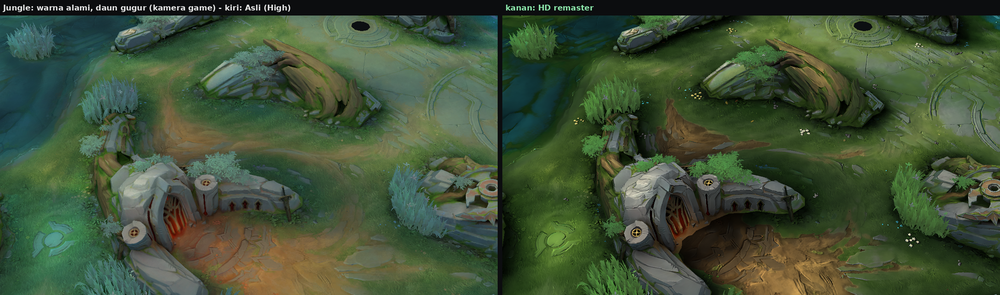
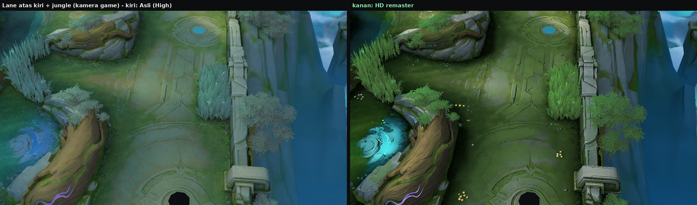
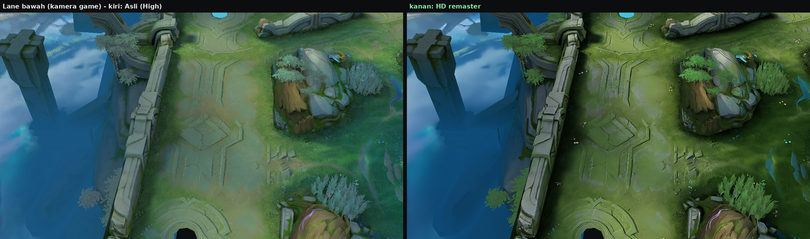
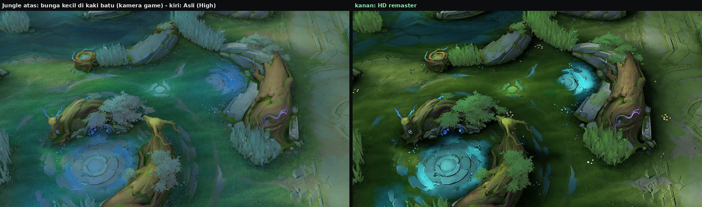
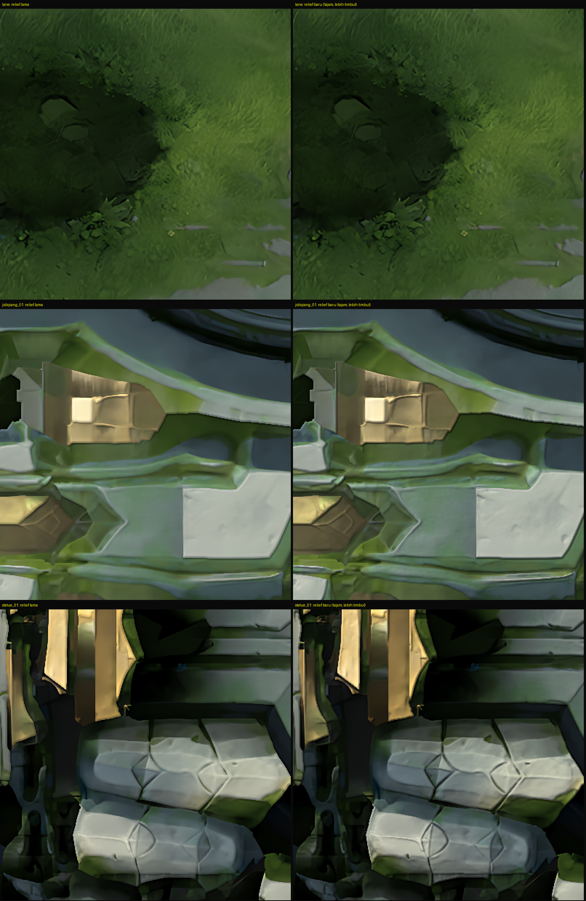
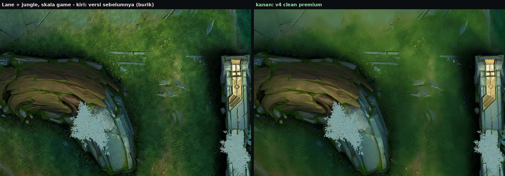
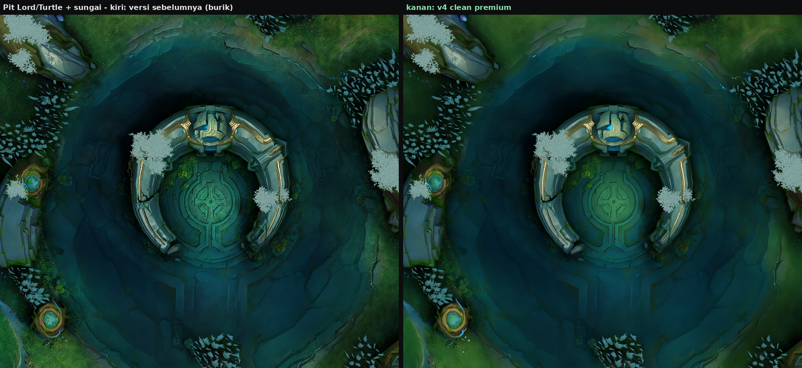
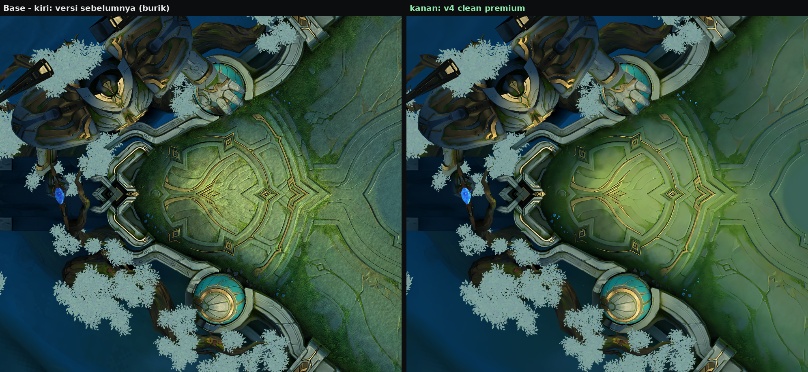
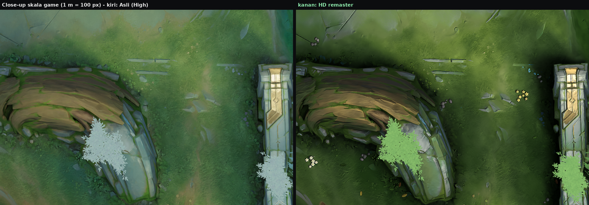

# Sanctum Island — HD Remaster v5 (grafik High)

**Unduh:** [`release/Sanctum_Island_Map_HD.zip`](release/Sanctum_Island_Map_HD.zip) (68 MB) — menggantikan
`Sanctum_Island_Map.zip`.

Struktur zip, nama file, urutan entri, dan kompresinya sama persis dengan file asli (`Scenes/android/...`). Cara
pasangnya juga sama: timpa file lama.

Sesuai permintaan, yang diubah **hanya scene grafik High** (`PVP_049_add.unity3d`). Tujuh file lain disalin
identik byte-per-byte: versi Low `PVP_049_low`, data jalur/tembok A* (`*wall_add`), `PVP_003_add`, `PVP_009`, dan
`GalleryCenter`.

**Seluruh peta High ikut berubah**, bukan hanya beberapa bagian:

- 16 dari 16 petak tanah, termasuk sungai.
- 40 dari 40 tekstur props: bangunan base, patung, tembok, batu jungle, pohon, tebing luar, pilar, kristal.
- Langit dan pulau melayang, 7 lightmap, rumput dan daun 3D, serta pantulan air.
- Baru di v5:
  - Warna alami ala referensi Dota 2, tidak warna-warni.
  - Daun jatuh dari 15 pohon pinggir map, dengan bentuk dan warna daun pohonnya.
  - Sedikit bunga kalem, kerikil, dan daun gugur di pinggiran rumput.
  - Relief yang lebih timbul.

Gambar di bawah adalah seluruh peta beserta bangunannya: atas asli, bawah remaster.


Ada beberapa hal yang memang **bukan bagian dari file map**, sehingga tetap seperti biasa: turret/tower, inti base,
monster jungle, Lord/Turtle, minion, hero, dan efek skill. Semuanya dimuat dari file game lain. Lubang hitam di
gambar tampak atas adalah posisi tower.


## Yang baru di v5: warna alami, daun jatuh, dekorasi tanah, relief lebih timbul

Gambar-gambar di bagian ini dirender dengan **sudut dan FOV kamera game asli** (`3DCamera_11` di scene) dan
pencahayaan baked map: kiri asli, kanan v5.



### Warna alami, referensinya screenshot Dota 2 (tidak warna-warni)

Warna di screenshot referensi saya ukur, lalu palet map dibuat mengikutinya. Hasilnya satu palet tanah-dan-hutan yang
menyatu. Nuansa biru-toska yang menutupi map aslinya dibuang:

| | Referensi Dota 2 | v4 | v5 |
|---|---|---|---|
| Rumput (hue / saturasi) | 82–88° / 0,34–0,51 | 109° / 0,58 (hijau kebiruan) | ±90° / ±0,5 |
| Tanah | oker 30–46° | oker | oker hangat ±39° |
| Batu (saturasi) | 0,11–0,13 | biru-abu | netral ±0,10 |

- **Rumput:** hijau-kuning saat kena matahari dan hijau tua di bayangan. Saturasinya dijaga di kisaran alami, jadi
  kaya warna tapi tidak mencolok.
- **Semak 3D dan daun pohon:** sebelumnya toska pucat, sekarang hijau alami yang lebih pekat.
- **Batu lane, paving, bangunan, dan patung:** abu-abu netral, bukan biru.
- **Tanah:** oker hangat.
- **Sungai:** toska-hijau gelap.
- **Cahaya:** matahari hangat di bagian terang, dan bayangan netral, tidak kebiruan.
- Kecerahan tanah naik 23% dari v4, tapi tetap ±30% lebih gelap dari peta aslinya dan lebih gelap dari referensi.
- **Aksen magis tetap:** lingkaran rune biru, trim emas, serta kristal dan orb warna tim. Kristal dan orb sengaja tidak
  diubah warnanya karena warnanya diatur game per tim.

### Daun jatuh yang cocok dengan pohonnya

- Daun **jatuh dari tempat daunnya berada**: ada satu emitter kecil di kanopi setiap pohon pinggir map, total 15.
- **Bentuk daun** sama dengan daun pohon map: oval dengan ujung runcing dan tangkai, terlipat di tulang daun, dengan
  urat halus.
- **Warnanya hijau alami** seperti daun pohonnya, dan tiap daun acak di antara dua nada hijau.
- Total ±40 daun hidup sekaligus. Seluruh efek ambient ±250 partikel dari 25 sistem.




### Dekorasi tanah baru

Semua dekorasi ini dilukis ke tekstur 16 petak tanah, jadi tidak ada objek tambahan, beban FPS-nya nol, dan tidak ada
yang bisa menghalangi gerakan.

Semua dekorasi hanya muncul **di rumput dan di pinggiran**, yaitu di kaki tembok, batu, pohon,
dan bangunan, 0,3–1,5 m dari tepinya. Tidak ada yang di tengah lane, di tanah terbuka, atau di air.

| Dekorasi | Jumlah | Tempat |
|---|---|---|
| Rumpun bunga kecil: 3–8 bunga 5/6 kelopak dan daun | 116 (jarak antar rumpun ≥5,5 m) | rumput di kaki tembok dan batu |
| Kelompok kerikil | 204 | rumput di kaki tembok dan batu |
| Daun gugur: hijau, menguning, atau cokelat kering | 222 | rumput di sekitar tanaman yang tumbuh di dinding jungle |

- **Bunga dibuat sedikit dan kalem**, supaya map tidak jadi warna-warni:
  - 50% krem putih, 25% kuning mentega pucat, 15% lilac lembut, 10% pink kusam.
  - Tidak ada warna terang atau neon.

- **Ditempatkan di koordinat dunia**, sehingga menyambung mulus antar petak.
- **Dicerminkan lewat pusat peta**, jadi kedua tim mendapat pemandangan yang sama.
- **Tiap dekorasi punya height map sendiri:**
  - Disinari dari arah cahaya peta.
  - Punya bayangan kontak.
  - Ikut terkena bayangan bangunan dan AO.
  - Digambar dengan supersampling 2×, jadi tajam, tanpa blur dan tanpa bintik.



### Relief lebih timbul dan tetap tajam

Relief sekarang ditambah lapisan halus (radius 0,4× dari relief dasar). Hasilnya, tepi blok batu, trim emas, ukiran
lantai, dan retakan batu terlihat seperti dipahat, dan tidak ada yang jadi buram.

- **Batu lane, paving, dan ukiran lantai:** emboss 0,11 → 0,13, ditambah lapisan halus. Rumput tetap lembut (0,04).
- **Semua props** (bangunan, patung, tembok, batu): emboss 0,06 → 0,10, ditambah lapisan halus.



## v4: tekstur bersih, tidak burik lagi

> Pembersihan tekstur dari v4 di bawah ini tetap dipakai. Palet warnanya sudah diganti palet natural v5 (lihat di
> atas).

Di versi sebelumnya tekstur terlihat **burik**: berbintik, bergaris halus, dan kotor kalau dilihat dekat. Ada tiga
penyebab, dan ketiganya sudah dibuang:

1. **Butiran buatan.** Untuk menambah "detail", versi sebelumnya menanam helai rumput dan butiran tanah dari noise,
   lalu mempertajamnya. Di layar HP, hasilnya terlihat sebagai pola garis halus yang kotor.
2. **AI yang "mengarang" tekstur.** Upscaler AI dipakai dengan 80% model tanpa *denoise*. Akibatnya kotak-kotak
   kompresi ASTC 8x8 dari tekstur asli ikut dibesarkan dan berubah menjadi pola acak.
3. **Kontras lokal dan sharpening di semua piksel.** Bercak dan butiran jadi makin menonjol.

Yang dilakukan v4, untuk **semua** tekstur (tanah, props, langit, rumput dan daun 3D):

- **Upscale AI yang bersih.** Campuran AI sekarang 45% model *denoise*. Artefak kompresi hilang, tapi sapuan
  lukisan aslinya tetap ada.
- **Filter painterly Kuwahara.** Setiap piksel mengambil warna dari sisi lingkungannya yang paling rata. Bintik,
  bercak, dan sisa kompresi berubah menjadi bidang lukisan yang bersih. Tepi tetap tajam (ukiran, retakan, tepi batu,
  trim emas), karena filter ini tidak pernah merata-ratakan melintasi tepi.
- **Tanpa noise buatan sama sekali.** Fungsi pembuat butiran dari versi sebelumnya sudah dihapus dari kode.
- **Sharpening hanya di struktur nyata.** Ukiran lane, tepi batu, dan trim dipertegas. Area rata seperti rumput dan
  air tidak pernah dipertajam.
- **Ukiran batu lebih timbul.** Relief di batu lane, paving, dan ukiran lantai hampir 3× lebih dalam daripada di
  rumput, jadi batu terlihat dipahat sementara rumput tetap lembut.
- **Palet premium:**
  - Rumput ke arah hijau emerald.
  - Tanah coklat tetap hangat, jadi jalur lane tidak berubah jadi hijau kusam.
  - Air dan dasar pit berwarna toska gelap yang bersih, tanpa bercak.
- **Ornamen berkilau.** Trim emas dan rune biru di lantai, bangunan, patung, dan kristal lebih bercahaya, dengan
  halo lembut.
- **Props sekarang ASTC 6x6** (sebelumnya 8x8), jadi tepi bangunan dan trim tidak berblok.

Hasil terukur pada 16 petak tanah:

- Energi butiran per piksel **turun 59%** dibanding versi sebelumnya.
- Kecerahan rata-rata hanya **1,5% lebih gelap**, jadi nuansa gelap yang diminta tetap sama.
- Kompresi ASTC 6x6 pada tekstur yang bersih mencapai PSNR **45–50 dB** terhadap versi tanpa kompresi.

Perbandingan dengan versi sebelumnya (kiri) dan v4 (kanan):





Di skala game (1 m = 100 px, kira-kira satu texel tanah per piksel layar), dibanding peta asli:



## Fitur yang tetap ada dari versi sebelumnya

- **Pewarnaan gelap dan dalam:** tanah tetap ±30% lebih gelap dari aslinya, dengan bayangan yang dalam. Di v5 tanah
  sedikit lebih terang dari v4 (+23%) mengikuti referensi. Props dan bangunan kecerahannya setara aslinya, tapi warnanya
  netral dan lebih kontras.
- **Bayangan setiap bangunan:** 181 bangunan dan props memberi bayangan nyata ke tanah, mengikuti arah cahaya peta.
- **AO:** gelap kontak di kaki bangunan, ditambah AO celah di dalam tekstur.
- **Emboss / relief:** permukaan batu, ukiran lane, dan props terlihat timbul.
- **Kilau ala PBR:** batu dan logam memantulkan cahaya, sedangkan rumput tetap matte.
- **Pantulan air ala SSR:** cubemap pantulan sungai 32 → 128 px, lebih tajam dan diberi grading gelap yang sama.
- **Efek ambient**: kunang-kunang, kilau sungai, aura pit, kilau base, debu cahaya (lihat bagian 6).

### Perbaikan: garis lurus / "terpotong" di dalam game

Di salah satu versi sebelumnya ada area berkabut dengan garis lurus di sekitar sungai dan pit, seperti layar
terpotong. Ada dua penyebab, dan keduanya sudah diperbaiki:

1. **Efek kabut sungai.** Partikelnya besar (hingga ±8 m) dan selalu menghadap kamera. Shader efek game tidak punya
   *soft particle*, jadi bidang kabut terpotong lurus di tempat ia menembus tanah, pohon, atau batu. Area di
   belakangnya terlihat seperti lapisan kabut bertepi tajam. **Efek kabut dihapus.** Kilau sungai juga dinaikkan
   supaya tidak menembus permukaan air.
2. **Pantulan air.** Mesh permukaan air menutupi sungai, pit, dan tepiannya dalam bentuk persegi panjang. Kalau
   pantulannya lebih terang dari aslinya, tepi persegi itu ikut terlihat. Material air sekarang **kembali ke nilai
   aslinya**, dan cubemap dibuat sedikit lebih gelap, tidak lebih terang.

> **Kenapa "baked":** SSR, shader PBR, dan shadow real-time adalah fitur renderer dan shader game. Keduanya ada di
> engine dan bundle shader MLBB, bukan di file map, jadi tidak bisa dinyalakan dari map. Karena itu semuanya saya
> *bake*: dihitung dari geometri dan arah cahaya asli peta, lalu ditanam ke tekstur dan cubemap. Dari kamera MOBA
> yang tetap, hasilnya terlihat sama, dan beban FPS-nya **nol**.


## 1. Tekstur sangat HD

Semua tekstur asli berformat ASTC 8x8 (kompresi paling kasar) tanpa mipmap. Tanah hanya punya ±52 texel per meter,
jadi di layar HP ia diperbesar ±2×. Itu sebabnya tanah terlihat buram dan berblok.

| Tekstur | Sebelum | Sesudah |
|---|---|---|
| 16 petak tanah + sungai (`hedaobake`) | 1024², ASTC 8x8 | **2048²**, ASTC 6x6, mipmap penuh |
| 40 props (patung, pohon, bangunan, tembok, kamp buff, tebing, kristal, …) | 512², ASTC 8x8 | **1024²**, ASTC 6x6, mipmap penuh |
| Langit / pulau melayang (`skybox`) | 512² | **1024²**, ASTC 6x6 |
| Rumput & daun 3D (cut-out) | 512² | **1024²**, ASTC 6x6, alpha di-upscale terpisah supaya tepi daun tetap tajam |
| 7 lightmap | 1024² / 512², ASTC 8x8 | ukuran sama, artefak blok dihaluskan, ASTC 6x6 |
| Cubemap pantulan air | 32 px, ASTC 8x8 | **128 px**, ASTC 6x6, 8 mip |
| Mask, noise air | 256² / 64² | 512² / 256² (noise air tetap seamless) |

Cara upscale-nya:

- **AI super-resolution:** Real-ESRGAN compact (`realesr-general-x4v3`, lisensi BSD-3), dijalankan lokal via
  ONNX Runtime. Bobotnya campuran 45% model *denoise* dan 55% model *no-denoise*: artefak kompresi hilang, sapuan
  lukisan tetap ada. Hasil ×4 diturunkan ke ×2 (supersampling).
- **Pembersihan painterly (Kuwahara umum, 8 sektor):** radius 2 texel di tanah, 3 texel di props, 2 texel di
  rumput/daun 3D. Langit memakai *guided filter*, supaya gradasinya mulus.
- **Sharpening tepi saja:** sharpening hanya bekerja di piksel yang punya gradien nyata (masker tepi). Area rata
  tidak disentuh.

## 2. Rumput, tanah, dan batu: bersih tapi detail

Satu texel tanah setelah 2× kira-kira 1 cm di dunia game. Pengaturannya:

- **Rumput:** sapuan lukisan aslinya dipertahankan dan dibersihkan, tanpa helai buatan, dengan warna hijau rumput alami.
- **Batu lane, paving, ukiran lantai:** relief dalam (emboss 0,13 plus lapisan halus), AO celah, dan kilau batu. Di
  rumput relief dibuat lembut (0,04).
- **Tanah coklat:** tetap hangat, dengan palet tanah sendiri.
- **Sungai dan pit:** bersih dan dalam, berwarna toska-hijau gelap. Dasar pit dan ukiran lantainya tetap terlihat.
- **Rumput dan daun 3D** (sprite cut-out): Kuwahara radius 2. Warna di area transparannya memang sudah diisi oleh
  artist aslinya, jadi tidak muncul pinggiran gelap.


## 3. Bayangan, AO, emboss, PBR, pantulan

- **Arah cahaya:** diambil dari parameter cahaya shader kristal peta (`_CustomLightDir` = 0,61 / 0,71 / -0,35).
  Artinya cahaya datang dari kanan-depan atas dengan elevasi ±45°, dan bayangan jatuh ke kiri-atas peta.
- **Bayangan bangunan:** setiap segitiga dari 181 mesh bangunan dan props diproyeksikan sepanjang arah cahaya ke
  permukaan tanah. Tinggi tanah diambil dari heightmap mesh tanah, jadi platform base yang lebih rendah juga benar.
  - Geometri yang terkubur di bawah tanah tidak memberi bayangan.
  - Tepi bayangan dibuat lembut (penumbra 2 tingkat).
  - Area bayangan diberi nada sedikit dingin, seperti cahaya langit.
  - Kekuatan bayangan 55%, lalu dipetakan ke tekstur 16 petak tanah lewat posisi dunia setiap texel.
- **AO kontak:** jejak geometri dalam 0,9 m dari tanah dibuat gelap lembut di sekeliling kaki bangunan, tembok,
  batu, dan pohon (40%).
- **AO celah:** retakan dan sambungan batu di dalam tekstur menjadi lebih gelap.
- **Emboss / relief:** normal dihitung dari luminansi tekstur yang sudah bersih, lalu disinari dari arah cahaya
  peta. Untuk tanah, arah cahaya dihitung per petak di ruang tekstur. Batu dan ukiran mendapat relief lebih dalam
  daripada rumput.
- **Kilau ala PBR:** specular dengan *half-vector* cahaya-kamera hanya di area batu dan logam (saturasi rendah,
  terang). Rumput dan daun hampir tanpa kilau, jadi materialnya terbedakan.
- **Pantulan air (pengganti SSR):**
  - Cubemap pantulan sungai 32 → 128 px, lebih tajam, dengan grading gelap yang sama seperti tanah.
  - Material air tidak diubah. Mesh air menutupi tepian sungai juga, jadi pantulan yang lebih kuat akan membuat tepi
    mesh-nya terlihat.


## 4. Pewarnaan

Satu palet natural yang sama untuk tanah, props, foliage, langit, dan lightmap, jadi semuanya serasi (lihat juga
"Warna alami" di atas):

- **Palet natural (`naturalize`)** menyusun ulang hue dan saturasi per kelompok warna:
  - Hijau dan toska jadi hijau rumput alami: ±74° di bagian terang, ±96° di bayangan, saturasi 0,34–0,52.
  - Foliage jadi hijau yang lebih pekat (±90–108°, saturasi 0,42–0,62).
  - Batu keabu-abuan jadi netral.
  - Batu biru bangunan dibuat lebih tenang.
  - Sungai jadi toska-hijau.
  - Tanah dan kulit kayu jadi oker hangat.
- **Grading:** *dehaze*, kontras mid-tone (tanah 0,20, props 0,15), dan *vibrance* sedang (0,12–0,18), supaya warnanya
  tidak mencolok:
  - tanah: gamma 1,00, exposure 1,00
  - props dan bangunan: gamma 1,02, exposure 0,98
  - langit: gamma 1,02, exposure 0,97
- **Split-tone:** sinar matahari hangat di highlight dan bayangan netral sedikit dingin, tanpa nuansa toska.
- **Ornamen berkilau:** trim emas +35% (props +21%) dan rune biru/toska +40% (props +24%), plus halo lembut.
- **Clarity rendah** (tanah 0,08, props 0,06), karena kontras lokal yang terlalu kuat membuat tampilan burik.

## 5. Halus dan ringan

- **Mipmap + trilinear** untuk tanah dan props. Tekstur tidak berkilau/bergerigi saat kamera bergeser, dan lebih
  ramah cache GPU.
- **Anisotropic filtering** 4× untuk tanah, 2× untuk props. Bagian atas layar yang terlihat miring tetap tajam.
- Rumput dan daun cut-out sengaja tanpa mipmap, supaya tidak menipis.
- Bayangan, AO, relief, dan kilau semuanya baked, jadi tidak ada biaya render tambahan.
- **Efek baru dibuat seringan mungkin:**
  - Total ±250 partikel dari 25 sistem. 15 di antaranya emitter daun kecil, masing-masing paling banyak 6 partikel.
  - Tanpa modul Noise atau Collision.
  - Simulasi world-space dengan *prewarm*, plus culling otomatis.
  - Hanya 4 tekstur kecil.
- **Dekorasi tanah** ada di dalam tekstur yang sudah ada, jadi ukurannya tidak bertambah.
- **Konsekuensi memori:**
  - Tekstur High naik dari 8,3 MB menjadi 68,4 MB. Sekitar 11 MB dari kenaikan itu karena props sekarang ASTC 6x6.
  - Bundle High naik dari 10,1 MB menjadi 63,6 MB.
  - Untuk perangkat yang memakai grafik High, ini masih wajar. Versi Low tidak tersentuh.

## 6. Efek baru di peta

| Efek | Lokasi | Tampilan |
|---|---|---|
| Kunang-kunang (4 area) | keempat area jungle | titik cahaya emas-hijau, melayang meliuk, berkedip |
| Kilau sungai | permukaan sungai | bintang kecil toska-putih berkelip, berputar |
| Aura lubang Lord / Turtle (2) | kedua *pit* | partikel cahaya toska → ungu naik perlahan |
| Kilau base (2) | sekitar orb kedua base | bintang putih-emas naik berputar. Warnanya netral, jadi tetap cocok saat warna tim ditukar |
| Debu cahaya | seluruh peta | butiran cahaya kecil melayang di udara |
| Daun berguguran (15) | di bawah kanopi 15 pohon pinggir map | daun hijau alami berbentuk daun pohon map, jatuh berputar dan bergoyang |


*Gambar efek di atas adalah simulasi tampak atas dari parameter efek yang terpasang, bukan screenshot game.*

Cara efek disisipkan:

- Efek adalah objek Unity biasa di scene High: GameObject + ParticleSystem + Renderer, ditambah material dan tekstur
  di sharedAssets.
- Tipe ParticleSystem diambil dari bundle Unity 2019.4.33f1 asli, dengan hash tipe yang identik dengan bundle game
  lainnya.
- Shader-nya memakai shader efek additive / alpha-blend yang sudah ada di bundle shader yang dipakai map ini. Shader
  itu ditambahkan ke PreloadData scene supaya ikut dimuat.
- Semua efek ada di layer yang sama dengan props peta (layer 10).

## Validasi

`tools/validate_map.py` ([log](docs/validate.log)) — **0 masalah**:

- 7 file selain scene High identik byte-per-byte.
- Header bundle dan nama file internal sama. Tidak ada objek asli yang hilang atau berubah tipe.
- Semua objek asli selain tekstur identik byte-per-byte, termasuk semua material (juga 8 material air). Ada dua
  pengecualian:
  - PreloadData: ditambah 2 shader efek.
  - Cubemap air: diganti versi 128 px (orientasi sama, tidak lebih terang).
- 1336 objek terbaca ulang lewat typetree.
- 73 tekstur ter-decode. Ukuran data cocok dengan format dan mipmap. Isi dan orientasinya berkorelasi dengan
  aslinya, tidak ada yang terbalik.
- Cubemap: ukuran per sisi dan total cocok. Keenam sisinya berisi, dengan orientasi yang sama seperti aslinya.
- Objek yang ditambahkan persis sesuai rencana:
  - 25 sistem efek + 1 root, 3 material efek, dan 3 tekstur efek.
  - Semua referensinya valid (komponen, hierarki, mesh, material → tekstur dan shader, PreloadData).
- Kapasitas partikel cukup. Total partikel di bawah anggaran 300.

Catatan: validasi ini memeriksa struktur file. Tampilan di dalam game belum bisa saya uji langsung di HP.

## Build ulang dari file asli

```bash
pip install -r tools/requirements.txt
# bobot Real-ESRGAN (resmi, BSD-3) — dimuat tanpa torch, lewat unpickler terbatas (tanpa eksekusi kode)
curl -LO https://github.com/xinntao/Real-ESRGAN/releases/download/v0.2.5.0/realesr-general-x4v3.pth
curl -LO https://github.com/xinntao/Real-ESRGAN/releases/download/v0.2.5.0/realesr-general-wdn-x4v3.pth
#   sha256 8dc7edb9ac80ccdc30c3a5dca6616509367f05fbc184ad95b731f05bece96292  realesr-general-x4v3.pth
#   sha256 1641f8c4464b9f097c9fdda5589273713f67cf59f3d909e0bd688f0cee269dca  realesr-general-wdn-x4v3.pth
python tools/sr_model.py realesr-general-x4v3.pth realesr-general-wdn-x4v3.pth 0.45 sr_dni45.onnx
#   sha256 c203fe1195582e3ae7f95f4d0f8657ccda78baa98a0255103babe41a8f146f37  sr_dni45.onnx
unzip Sanctum_Island_Map.zip -d orig        # -> orig/Scenes/android/...
python tools/build_map.py orig/Scenes/android out/Scenes/android report.json sr_dni45.onnx 4
python tools/validate_map.py orig/Scenes/android out/Scenes/android
python tools/map_previews.py orig/Scenes/android/PVP_049_add.unity3d out/Scenes/android/PVP_049_add.unity3d previews
python tools/pack_like.py Sanctum_Island_Map.zip out Sanctum_Island_Map_HD.zip
```

Build dari nol memakan ±15 menit dengan 4 core. Kalau variabel `MAP_SR_CACHE=<folder>` diisi, hasil AI
disimpan di cache dan build berikutnya ±8 menit, dengan hasil yang identik.

SHA-256 zip: `77512cbc90026d8999bec81ba946250124996d6d7b18dbda14df5c7a0f30479c`. Zip ini dibangun dengan cache hasil
AI. Build-nya deterministik: inferensi AI memakai jumlah thread yang sama dan penempatan dekorasi memakai seed tetap.
Versi sebelumnya sudah terbukti identik saat dibangun ulang dari nol tanpa cache.

| Tool | Fungsi |
|---|---|
| `sr_model.py` | muat bobot Real-ESRGAN tanpa torch, campur denoise, ekspor ONNX, upscale ×2 per tile |
| `map_hd.py` | pembersihan painterly (Kuwahara), palet natural (referensi Dota 2), kilau ornamen, sharpening tepi, grading |
| `map_decor.py` | bunga kecil, kerikil, daun gugur: sprite prosedural dengan height map, penempatan di koordinat dunia (pinggiran rumput saja), pencahayaan dan bayangan kontak |
| `map_fx.py` + `map_fx_templates.json` | efek ambient baru dan penyisipannya ke scene (template tipe ParticleSystem Unity 2019.4.33f1) |
| `build_map.py` | build lengkap scene High |
| `validate_map.py` | validasi di atas |
| `map_render.py`, `map_previews.py` | render peta tampak atas dan dari kamera game (perspektif, lightmap baked, foliage alpha-test) serta pratinjau |
| `pack_like.py` | zip dengan entri / urutan / kompresi sama seperti zip asli |
