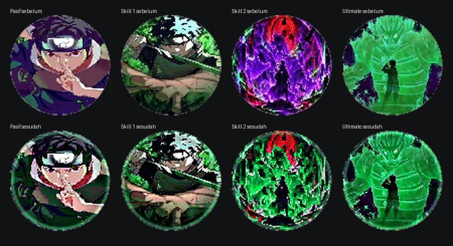
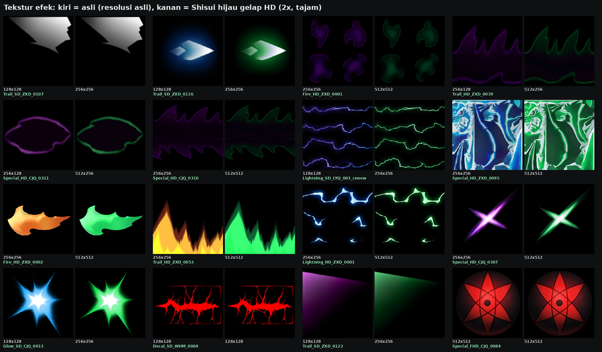
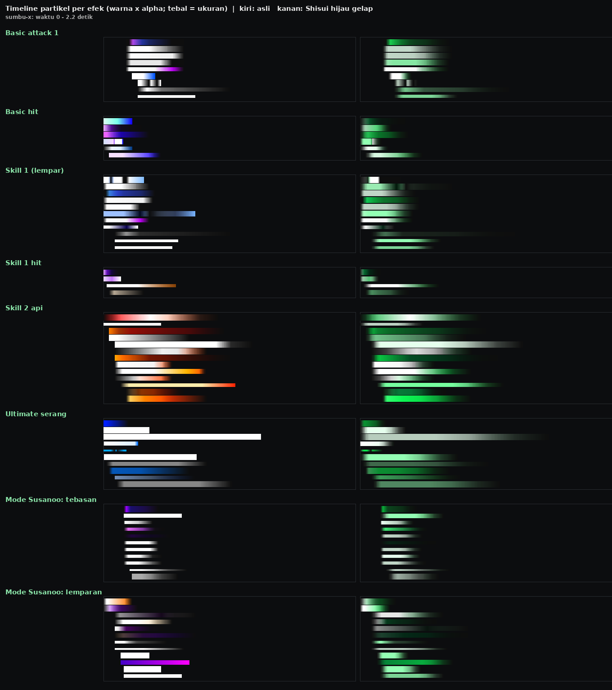

# Shisui x Suyou — Dark Green Revamp

**Unduh (pasang dua-duanya):**

| File | Menggantikan | Isi |
|---|---|---|
| [`release/Shisui_x_Suyou_DarkGreen_Effects.zip`](release/Shisui_x_Suyou_DarkGreen_Effects.zip) | `shisui.zip` | `Art/android/k`, `zzp1_k`, `zzp2_k`: semua efek skill, basic attack, hit, mode Susanoo, recall/lobby |
| [`release/Shisui_x_Suyou_DarkGreen_Skin.zip`](release/Shisui_x_Suyou_DarkGreen_Skin.zip) | `DAA [Shisui x Suyou] (DEFAULT).zip` | `shisoui x soyou/`: model, lengan Susanoo, audio, UI (ikon skill) |

Struktur folder, nama file, urutan entri, dan kompresi zip sama persis dengan file asli. Cara pasangnya juga
sama: timpa file lama dengan isi kedua zip ini.



## 1. Semua efek dominan hijau gelap

Ungu, biru, dan oranye diganti jadi palet hijau gelap:

- **Bagian gelap:** teal-zamrud tua (≈152°).
- **Bagian tengah:** zamrud (≈146°).
- **Highlight paling panas:** mint-putih (≈138°).

Yang diubah:

- **484 dari 484 sistem partikel:** warna awal (start color), gradient warna sepanjang umur, warna trail, dan
  warna custom data. Validator menghitung **100% warna partikel berwarna sudah hijau**.
- **632 properti warna material**: warna diffuse, gradient-map (`_LeftColor`/`_RightColor`), height-gradient, warna
  tepi dissolve, fresnel, flowing light, dan lain-lain. Putih, abu-abu, dan hitam tetap, karena di shader fungsinya
  sebagai pengali intensitas. Hue-shift shader (`_Hue`) dinolkan karena teksturnya sendiri sudah hijau.
- **372 tekstur efek**. Hanya texel berwarna yang di-recolor. Inti putih tetap putih-mint, jadi kilatan tetap
  terasa panas.
- **Kurva warna animasi mesh** (efek legacy) ikut jadi hijau.

Pola warnanya:

- Layer *alpha-blend* (asap, tebasan gelap, `andi`/`heiyan`) dibuat 16% lebih gelap, jadi hijau hutan pekat.
- Layer *additive* (glow, petir, percikan) jadi zamrud menyala dengan inti mint-putih.
- Ungu→hijau dibuat sedikit lebih redup (koreksi luminansi), supaya skin tetap terasa gelap dan tidak neon.
- Semua partikel memudar sambil mendingin ke hijau tua.

Yang **sengaja tidak** dijadikan hijau:

- Sharingan / Mangekyō Sharingan (merah)
- Mata berdarah di animasi lobby
- Gambar karakter di efek easter-egg
- Batang kayu jurus pengganti (substitution)
- Logam shuriken



## 2. Lebih besar, brutal, menggelegar

Setiap partikel efek pertempuran diberi peran dari nama GameObject-nya (pinyin): `dg` = tebasan, `shandian` = petir,
`lizi` = percikan, `shitou`/`sui` = puing, `heiyan`/`andi` = lapisan gelap, `yan`/`smoke` = asap, `huo`/`fire` = api,
`dilie` = retakan tanah, `quan`/`huan` = cincin kejut, `glow`/`guang` = kilatan.

| Peran (jumlah di efek pertempuran) | Ukuran | Lainnya |
|---|---|---|
| Kilatan / glow (31) | ×1,30 | mulai 85% lalu *snap* ke 100%, mekar 18% saat memudar, kilatan putih-mint saat lahir |
| Petir (22) | ×1,30 | +25% partikel, kilatan putih-mint saat lahir |
| Cincin kejut (4) | ×1,30 | mengembang 15% saat memudar |
| Percikan (54) | ×1,15 | +40% partikel, 25% lebih cepat, kepala putih-mint; yang sangat cepat melambat halus (drag) |
| Puing / batu (17) | ×1,20 | +35% partikel, 20% lebih cepat, **jatuh** oleh gravitasi |
| Tebasan (42 + 25 gelap) | ×1,15 | *whip-in* 86→100%, mengembang 12–15% sambil memudar, hidup 15–20% lebih lama |
| Asap (25) / lapisan gelap (15) | ×1,25 / ×1,20 | mengembang 25% / 12%, ekor 25% / 20% lebih panjang |
| Api (14) | ×1,20 | +15% partikel, partikel api billboard **naik** |
| Retakan tanah (7) | ×1,25 | bertahan 35% lebih lama |

Material additive yang hanya dipakai kilatan, petir, atau cincin kejut di efek pertempuran (26 material) dibuat
15% lebih terang (`_Intensity`). Hasilnya inti ledakan terasa lebih "menggelegar".

Yang tidak dibesarkan: indikator area skill 2 (`skill02_warning`, harus tetap sesuai area asli), cut-in UI
ultimate, animasi lobby/CityAction, dan easter-egg. Bagian ini tetap di-recolor dan diberi fade.

Optimasi: emitter yang sangat padat (ult dan animasi lobby) dikompres. Total perkiraan partikel hidup bersamaan
dari semua efek justru turun sedikit, **3531 → 3462**, walau efek pertempuran sekarang lebih padat.

## 3. Tekstur HD tajam

- **364 tekstur** ≤256 px di-upscale **2×**: 64→128, 128→256, 256→512, maksimal 512 px.
  - Upscale-nya *premultiplied Lanczos*, jadi tepi transparan tidak berpinggiran gelap.
  - Setelah itu dipertajam dengan *edge-aware unsharp mask* pada warna dan alpha. Gradien halus (glow) tidak
    dipertajam, jadi artefak blok tidak ikut menonjol.
- Tekstur 512 px tetap ukurannya, hanya dipertajam.
- Tekstur data tidak disentuh: mask, noise, dissolve, displacement, ramp, dan peta channel-packed lengan Susanoo
  (`pbs_m`).
- Format tetap sama dengan aslinya (ETC2 RGBA8 / ETC1 / ASTC), mipmap dibuat ulang.
- Konsekuensinya, zip efek naik dari 7,3 MB ke 16,5 MB.

## 4. Fade-in & fade-out di semua efek

- **484/484** sistem partikel mulai dan berakhir di alpha 0. Fade-in dan fade-out pakai kurva S. Efek pertempuran
  dapat ekor sinematik (fade-out panjang mulai 40–55% umur) dan memudar ke hijau tua.
- Efek mesh (legacy): fade-in alpha, tidak ada lagi efek yang langsung hilang (pop-out), tangen kurva dihaluskan.
- Umur efek (`DelayTime`) diperpanjang untuk 32 efek, dihitung bersama overlay `zzp1_`/`zzp2_`, supaya tidak ada
  fade-out yang terpotong. Di file asli beberapa efek sudah terpotong. Contohnya asap basic attack 3 hidup sampai
  1,15 dtk, tapi efeknya dihapus di 0,53 dtk.



## 5. Ikon skill

Ikon Suyou ada di atlas bersama `Atlas_SkillIconAdd35_add`. Yang diubah hanya S12610 (pasif), S12620 (skill 1),
S12630 (skill 2), dan S12640 (ultimate):

- Energi ungu/biru jadi zamrud gelap.
- Hijau yang sudah ada diperdalam.
- Kontras sinematik, *clarity*, vignette lembut, plus garis rim mint tipis di tepi lingkaran.
- Sharingan merah dan warna kulit tetap.

Atlasnya ETC1. Hanya 2652 dari 65536 blok 4×4 yang di-encode ulang, yaitu blok yang menyentuh empat ikon itu. Ikon
hero lain di atlas yang sama tetap identik byte-per-byte.

## Yang tidak diubah

Model Shisui (`hero_kaijiacike_skin`), kartu hero (`Hero1261_add`), audio (`*.bnk`), dan file penanda
`Kaijiacike_skill03_ui.unity3d` (12 byte) disalin persis seperti aslinya.

## Validasi

`tools/validate_shisui.py` ([log](docs/validate.log)) — **0 masalah**:

- File yang tidak diubah identik byte-per-byte.
- Header bundle, nama CAB internal, dan set objek sama dengan aslinya. Semua objek bisa dibaca ulang dengan struktur
  key yang sama.
- 655 tekstur ter-decode dengan orientasi benar. Sinyal "terlihat" (value × alpha) berkorelasi dengan aslinya, dan
  tidak ada yang terbalik.
- Palet: 100% warna partikel berwarna ada di rentang hijau.
- 484/484 sistem partikel punya fade-in dan fade-out. Tidak ada `maxParticles` yang berlebihan.
- 39 efek dicek: `DelayTime` selalu ≥ akhir fade terakhir, termasuk overlay.
- Atlas ikon: piksel berubah hanya di dalam 4 ikon Suyou. Tidak ada sprite hero lain yang tersentuh.

Build juga deterministik. Build ulang dari tools di repo menghasilkan kedua zip dengan SHA-256 yang sama:

- Effects: `cab618b6cfeda0333de6b48775a27d86d4753b2306ceae9c5cbedcf363ce1b05`
- Skin: `3114bf247fb8ae15d101bd91ccfa32241b99b3d8253c1658aed3db09b57045e5`

## Build ulang dari file asli

```bash
pip install -r tools/requirements.txt
unzip shisui.zip -d orig_fx                               # -> orig_fx/Art/android/...
unzip "DAA [Shisui x Suyou] (DEFAULT).zip" -d orig_model  # -> orig_model/shisoui x soyou/...
python tools/build_shisui.py orig_fx "orig_model/shisoui x soyou" out_fx "out_model/shisoui x soyou" report.json 4
python tools/validate_shisui.py orig_fx/Art/android "orig_model/shisoui x soyou" out_fx/Art/android "out_model/shisoui x soyou"
python tools/pack_like.py shisui.zip out_fx Shisui_x_Suyou_DarkGreen_Effects.zip
python tools/pack_like.py "DAA [Shisui x Suyou] (DEFAULT).zip" out_model Shisui_x_Suyou_DarkGreen_Skin.zip
```

| Tool | Fungsi |
|---|---|
| `green.py` | palet hijau gelap: warna partikel, material, kurva animasi, tekstur |
| `brutal.py` | peran partikel → ukuran / jumlah / kecepatan / fade sinematik / kilatan |
| `fx_tex_hd.py` | upscale 2× + penajaman + recolor + encode ETC1/ETC2/ASTC/RAW |
| `icons.py` | grading ikon + encode ulang ETC1 hanya pada blok yang berubah |
| `build_shisui.py` | build lengkap (efek, lengan Susanoo, ikon, DelayTime) |
| `validate_shisui.py` | validasi di atas |
| `shisui_previews.py`, `icon_preview.py` | gambar pratinjau |
| `pack_like.py` | zip dengan entri / urutan / kompresi sama seperti zip asli |
| `shisui_survey.py`, `shisui_show.py`, `tex_sheet.py` | survei bundle (shader, material, tekstur, warna) |
